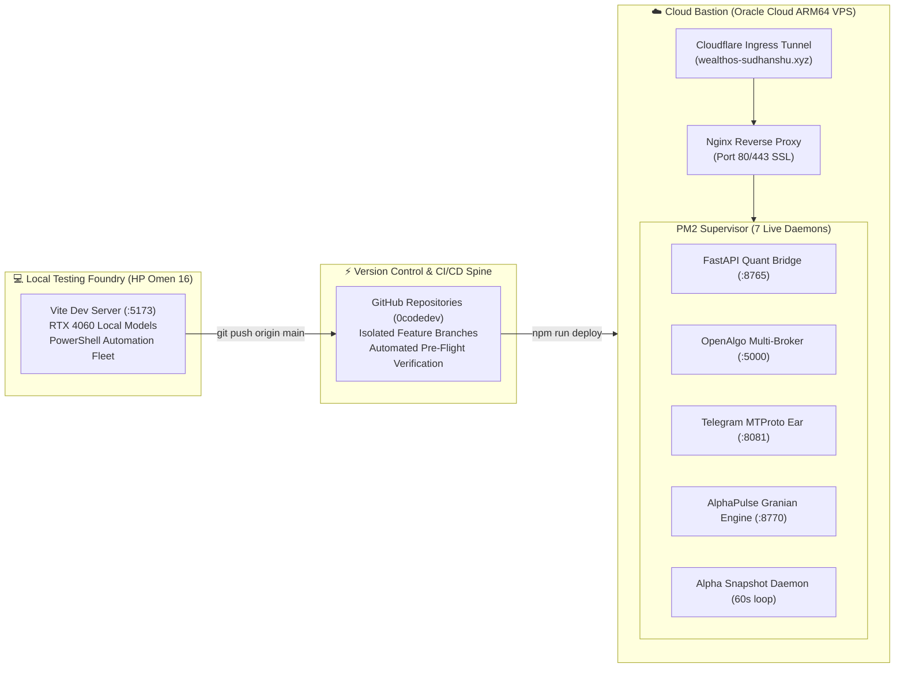

# 🏛️ Sudhanshu Gaddam (`0codedev`)

### **Quantitative Systems Architect & High-Leverage Platform Engineer**
*Scholar @ National Institute of Technology, Warangal (NIT Warangal)*

  <b>Architecting, operating, and scaling real-time quantitative trading engines, mathematical ephemeris systems, and autonomous agentic workflows at ₹0 infrastructure cost.</b>

---

## 🌐 Production Infrastructure & Cloud Topology

All live production workloads run 24/7/365 on an isolated, zero-cost cloud topology orchestrated through pure Git deployment pipelines:

---

## 🔭 Flagship Systems Architecture

### 1. [WealthOS v2](https://github.com/0codedev/wealthos) — *Autonomous Wealth Terminal & Algo Engine*
> **Live Production:** [wealthos-sudhanshu.xyz](https://wealthos-sudhanshu.xyz) | **Tech:** React 19, TypeScript, Python 3.11, FastAPI, DuckDB, SQLite3, Vite, Tailwind CSS

- **Autonomous Algorithmic Trading:** Real-time Black-Scholes Greeks engine ($\Delta, \Gamma, \Theta, \nu$) offloaded to vectorized C/SciPy kernels with implied volatility surfaces.
- **Columnar OLAP Engine:** DuckDB + Apache Arrow engine querying rolling 20-day Average Daily Volume (ADV), ATR, and High/Low across **1,400+ NSE stocks in 43ms** without server memory bloat.
- **Multi-Broker Gateway:** Sub-second order routing, bracket order sanitizers, and portfolio reconciliation across Upstox Pro binary Protobuf WebSockets and Dhan HQ REST.
- **Parent-Threaded Telegram Telemetry:** Automated execution alerts, trailing stop ratchets, and post-trade autopsies routed to dedicated Telegram topic threads.

---

### 2. [AlphaPulse Terminal](https://github.com/0codedev/alphapulse-terminal) — *Autonomous Multi-Scanner Terminal*
> **Live Production:** [alpha.wealthos-sudhanshu.xyz](https://alpha.wealthos-sudhanshu.xyz) | **Tech:** React 19, Granian ASGI, Polars, TypeScript, Tailwind CSS

- **14 Core Trading Scanners:** 1-to-1 institutional parity replicating Market Pulse, Insider Strategy, Sector Scope, Swing Spectrum, Option Clock, and Trading Journal.
- **Sub-Millisecond ASGI Engine:** Granian ASGI backend serving authenticated lot sizes, strikes, and live tick volume with zero JWT drift.
- **Multi-Viewport Architecture:** Verified across Mobile (412px OnePlus 13), Tablet, and Desktop (1920px) with 0px horizontal layout leaks.

---

### 3. [Cosmic Matrix](https://github.com/0codedev/cosmic-matrix) — *Vedic Ephemeris & Planetary Analytics System*
> **Live Production:** [cosmovedic.vercel.app](https://cosmovedic.vercel.app) | **Tech:** Next.js 14 (App Router), TypeScript, Prisma ORM, PostgreSQL, Tailwind CSS

- **High-Precision Ephemeris Math:** Sub-arcsecond celestial coordinate calculations, Lahiri / KP Ayanamsha algorithms, and real-time house cusp alignment.
- **Divisional Charts (Varga):** Comprehensive SVG rendering for North Indian and South Indian Kundli (D1 to D60 charts), Shadbala planetary strength, and 120-year Vimshottari Dasha explorer.
- **Astrological AI Engine:** Conversational chart synthesis powered by LLM inference, Muhurta timing finders, and planetary transit timelines.

---

### 4. [JEE Workspace v2.0](https://github.com/0codedev/jee-workspace) — *Cognitive Diagnostic & Revision Engine*
> **Live Production:** [jee-workspace.vercel.app](https://jee-workspace.vercel.app) | **Tech:** React, TypeScript, Vite, KaTeX, Zustand, IndexedDB, Firebase Firestore, PWA

- **13-Tab Diagnostic Suite:** Parity with NTA CBT exam simulation environments, ExamGOAL import pipelines, and error root-cause analytics.
- **SM-2 Spaced Repetition:** SuperMemo SM-2 memory retention engine for automated formula review intervals and cognitive burnout detection.
- **Formula Vault & Memory Anchors:** High-pitfall formula bank with KaTeX mathematical rendering, multi-domain bridge equations, and live rank predictors.

---

### 5. [OpenAlgo Platform (Fork)](https://github.com/0codedev/openalgo) — *Multi-Broker Execution Layer*
> Synchronized upstream fork maintaining 151 merged commits and 31 SQLite schema migrations.

- **Broker Execution:** Multi-broker order translation layer (DhanHQ, Upstox, Flattrade, Fyers) supporting Bracket Orders, Stop-Loss Limits, and Limit-Order Chaser algorithms.
- **Zero-Trust Security:** Token-gated WebSocket proxies on port 8081, zero broker credential leakage, and Google Account identity binding.

---

## 🛠️ Technical Competencies & Systems Stack

| Domain | Technologies & Frameworks |
|---|---|
| **Languages & Runtimes** | Python 3.11+, TypeScript 5.8+, JavaScript (ESNext), SQL, C++, Bash / PowerShell |
| **Quant Math & Data** | DuckDB (Columnar OLAP), PyArrow, VectorBT (Numba SIMD), NumPy, Pandas, SciPy, Mibian (BSM Greeks), Polars |
| **Frontend & Cockpit** | React 19, Next.js 14, Vite 6, Tailwind CSS, Framer Motion, TradingView Lightweight Charts, Recharts, Dexie.js (IndexedDB), Zustand, KaTeX |
| **Backend & ASGI** | FastAPI, Uvicorn, Granian, Node.js, WebSockets, Google Protocol Buffers (Protobuf), Telethon (MTProto) |
| **Cloud & DevOps** | Oracle Cloud Always-Free ARM VPS, Ubuntu Linux, PM2 Process Supervisor, Cloudflare Tunnels, Nginx, Git Worktrees |
| **Broker Protocols** | DhanHQ Open API, Upstox v2 API, OpenAlgo Gateway |

---

## ⚡ The Agentic Systems Methodology

As an **Agentic Systems Architect**, I design system topologies, establish state boundaries, enforce strict invariant gates, and orchestrate frontier AI fleets to deliver verified, production-grade software:

* **Mechanical Worktree Isolation**: Risky experiments run in dedicated Git Worktrees (`treehouse`), preserving production integrity.
* **Deterministic Pre-Flight Checks**: 1-command release pipelines (`scripts/deploy.ps1`) executing pre-flight syntax checks, remote Git fast-forwards, native Vite compilation, and zero-drop PM2 reloads.
* **First-Principles Verification**: Always inspecting raw network payloads, computed styles (CDP port 9222), and transport layer sockets before proposing solutions.

---

## 🎓 Academic Background

- **National Institute of Technology, Warangal (NIT Warangal)**
  - B.Tech Undergraduate
  - 2nd Place (Runners-Up), Intramurals Tournament
  - Executive Member, SPIC MACAY NIT Warangal Student Chapter

---

### 📊 GitHub & Algorithm Activity

  
  

---

**Reach Out & Connect:**  
📧 `gaddasudhanshu@gmail.com` · 🌐 [wealthos-sudhanshu.xyz](https://wealthos-sudhanshu.xyz) · 📍 NIT Warangal, Telangana, India

